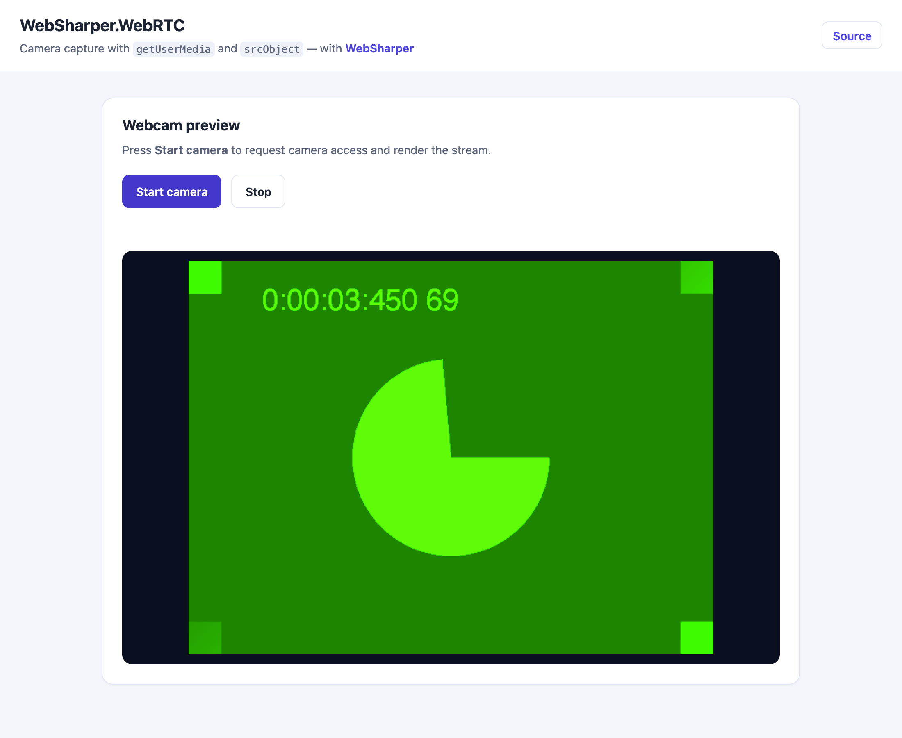

# WebSharper.WebRTC

[](https://www.nuget.org/packages/WebSharper.WebRTC)

WebSharper bindings for the browser [WebRTC](https://developer.mozilla.org/en-US/docs/Web/API/WebRTC_API)
media-capture API — **`navigator.mediaDevices.getUserMedia`**, the camera/microphone
stream types, and `HTMLVideoElement.srcObject` — for F# and C# web apps.

This repository contains:

| Project | Purpose |
|---|---|
| `WebSharper.WebRTC` | The binding: `MediaStreamConstraints`, the `MediaStreamError` family and the legacy `UserMedia` type. |
| `WebSharper.WebRTC.Extensions` | The modern entry points: `getUserMedia` on `MediaDevices` and the `srcObject` accessor on `HTMLVideoElement`, which are inline F# helpers layered on the core `WebSharper.JavaScript` types. |
| `WebSharper.WebRTC.Sample` | A runnable WebSharper 10 SPA that captures the webcam and renders it. |

Both assemblies ship in the single `WebSharper.WebRTC` NuGet package.

## Live demos

- **Binding sample (this repo):** https://dotnet-websharper.github.io/webrtc/
- **Sample in the WebSharper samples gallery:** https://websharper-samples.github.io/WebRTC/
- **Sample source in the gallery:** https://github.com/websharper-samples/WebRTC
- **WebSharper:** https://websharper.com



> Camera capture requires a secure context (`https://` or `localhost`) and the
> user's permission. For automated/headless runs, launch a Chromium-based browser
> with `--use-fake-ui-for-media-stream --use-fake-device-for-media-stream`.

## Install

```bash
dotnet add package WebSharper.WebRTC
```

Or with Paket:

```fsharp
nuget WebSharper.WebRTC
```

The package targets `netstandard2.0` and works with any WebSharper 10 project.

## Usage

Core already models the media types (`MediaDevices`, `MediaStream`,
`MediaStreamTrack`, `MediaDeviceInfo`, the media-constraint types and
`HTMLVideoElement`) in the `WebSharper.JavaScript` namespace, and `navigator`
exposes `mediaDevices` there. The binding reuses those and complements them
with the two pieces core is missing.

### Capture the camera

```fsharp
open WebSharper
open WebSharper.JavaScript
open WebRTC

[<JavaScript>]
let StartCamera (video: HTMLVideoElement) =
    // video/audio are optional; MediaStreamConstraints(video = true) requests video only.
    let constraints = MediaStreamConstraints(Video = true)

    GetUserMedia JS.Window.Navigator.MediaDevices constraints
        .Then(
            (fun (stream: MediaStream) ->
                SetSrcObject video stream   // video.srcObject <- stream
                video.Play() |> ignore
                ()),
            (fun (err: obj) ->
                let e = As<MediaStreamError> err
                Console.Error($"Camera error ({e.Name}): {e.Message}")
                ())
        )
    |> ignore
```

Which compiles to exactly the standard, Promise-based browser API:

```javascript
navigator.mediaDevices.getUserMedia({ video: true })
    .then(stream => { video.srcObject = stream; video.play(); })
    .catch(err => console.error(err.name + ": " + err.message));
```

`JS.Window.Navigator.MediaDevices`, `MediaStream`, `HTMLVideoElement` and the
constraint types all come from `WebSharper.JavaScript`; `MediaStreamConstraints`
and `MediaStreamError` come from this binding.

### Detach the stream

```fsharp
[<JavaScript>]
let StopCamera (video: HTMLVideoElement) =
    ClearSrcObject video   // video.srcObject <- null
```

### Notes on the API

- `GetUserMedia`, `SetSrcObject` and `ClearSrcObject` live in the
  `WebSharper.WebRTC.Extensions` assembly (namespace `WebRTC`, module
  `Extensions`, which is `AutoOpen`). They are `[<Inline>]` helpers over the core
  types, so they compile to plain `getUserMedia` / `srcObject` JavaScript with no
  runtime overhead.
- `MediaStreamConstraints.Video` and `.Audio` accept either a `bool` or a
  `MediaTrackConstraints` (e.g. `MediaStreamConstraints(Video = true)`, or
  `MediaStreamConstraints(Audio = true)` for the microphone).
- Errors reject with a DOMException-like object; use `As<MediaStreamError>` to
  read the typed `.Name`, `.Message` and `.ConstraintName` members.
- The legacy `UserMedia` class (the removed `navigator.getUserMedia` callback API)
  is kept for source compatibility but is marked `Obsolete`; prefer
  `GetUserMedia`.

## Build from source

### Prerequisites

- [.NET SDK](https://dotnet.microsoft.com/download) 9.0 or later.
- [Node.js](https://nodejs.org/) (LTS) for the esbuild bundle step.
- [Paket](https://fsprojects.github.io/Paket/) as a local dotnet tool (already
  configured in `.config/dotnet-tools.json`).

### Restore and build

```bash
dotnet tool restore
dotnet tool run paket restore
dotnet build WebRTC.sln -c Release
```

### Run the sample

The sample is a static WebSharper 10 SPA. Building it in Release produces the
self-contained site in `dist/`:

```bash
cd WebSharper.WebRTC.Sample
dotnet build -c Release
# then serve the generated site, e.g.
npx serve ../dist
# or
python3 -m http.server -d ../dist 8080
```

Open the served URL (camera access needs `localhost` or `https://`).

### Pack the NuGet package

After a Release build (so the assemblies exist in `bin/Release/netstandard2.0`):

```bash
dotnet tool run paket pack ./out
```

The resulting `.nupkg` contains both `WebSharper.WebRTC.dll` and
`WebSharper.WebRTC.Extensions.dll` under `lib/netstandard2.0`, plus the binding source.

### Deployment

Pushing to `master` triggers `.github/workflows/ghpages.yml`, which builds the
sample in Release and publishes `dist/` to the `gh-pages` branch via GitHub Pages.

## Repository layout

```
WebSharper.WebRTC/                # the binding
  Main.fs                         # MediaStreamConstraints, MediaStreamError, UserMedia
WebSharper.WebRTC.Extensions/     # modern getUserMedia + srcObject helpers
  Library.fs
WebSharper.WebRTC.Sample/         # WS10 SPA sample
  Client.fs
  index.html                      # template (ws-onclick / ws-var)
  css/index.css
  esbuild.config.mjs
nuget/                            # Paket pack template
.github/workflows/ghpages.yml     # build + deploy sample to gh-pages
```

## License

Apache 2.0 — see [LICENSE.md](LICENSE.md).
